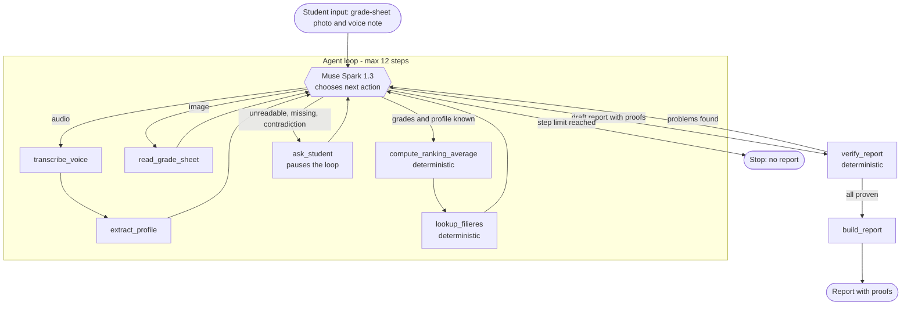

# PathProof (Meta Global AI Developer Hackathon)

[](https://github.com/AresGn/PathProof-Meta-Hackathon/actions/workflows/tests.yml)

> **Every study path comes with its proof.**

An agent that takes a post-BAC student's grade-sheet photo and a short voice note, chooses its own tools step by step, and produces an orientation report in which every sentence points to its proof: a grade read on the photo, a quote from the transcript, a row of the official guide, or a calculation. It recommends only what it can prove, and it stops to ask the student instead of guessing.

> **Status: build period 27 Oct - 3 Nov 2026.** The agent loop runs end to end from the CLI (`python -m src.main --image … --audio …`, story E4.4): real tools, journal in `evals/results/`, `ask_student` on stdin. Unit tests still use a fake model only; CI never calls the Meta API. Nothing in this README describes behavior that does not run.

**Track:** Indie Developer. **Theme:** Build for Your World. Full plan: [`docs/prd.md`](docs/prd.md).

## Problem

A student in Benin often picks a program on vague grounds (the BAC series, family opinion, rumor) without seeing which programs are open to the real profile, or where the official information is.

- Sourced figure on the number of BAC candidates: **TODO** (see `docs/impact.md`). No number is stated until an official source is added.

## What PathProof does differently

1. **The agent decides.** It picks the next tool from what it observes (blurry photo, missing grade, contradiction) and pauses to ask the student.
2. **The model does not calculate.** The per-program ranking average (official formula, page 8 of the 2026-2027 guide) and the filtering of offers are deterministic code, called as tools.
3. **Every sentence has proof.** A code-based verifier blocks any claim without a proof reference.

## What is new in this repository

All the code in this repository is written during the hackathon: the agent loop, the tools in `src/tools/`, the Meta API client, the evaluation cases in `evals/`, the demo web page and API stub (`web/`, `src/api/`). The one exception is the data in `data/`, extracted from the official guide before the event (see **Data** below).

**An earlier prototype** by the same author (OrientBot V1, a fixed WhatsApp workflow, 7 users, now paused) explored this problem. No code from it is reused here. PathProof is built from scratch during the hackathon. Only public official rules (the MESRS weighted-average formula, subject-name normalization) are re-implemented. See [`docs/v1-reuse.md`](docs/v1-reuse.md).

**Data** comes from the official public *Guide d'information 2026-2027* (MESRS). Its CSV extraction was done before the event; it is data, not code. The guide PDF itself is not republished here. Every recommendation is meant to link back to the guide page it comes from (`data/pages_offres.csv` maps all 224 offers to their PDF page: 180 matched without ambiguity, 23 disambiguated by establishment sigle, the rest checked by hand against the local PDF, including the 7 formerly quarantined rows whose labels E3.5 repaired).

| File | Content |
|---|---|
| `data/offres_publiques_2026_2027.csv` | 224 public offers: series, entry mode, subjects, careers, grant quotas, quality status |
| `data/series_et_offres_2026_2027.csv` | 897 series-to-offer pairs |
| `data/controle_qualite_2026_2027.csv` | 39 extraction anomalies (quality-control log) |
| `data/pages_offres.csv` | Offer to PDF page mapping (draft) |
| `data/coefficients_bac_benin.json` | BAC coefficients per series (Office du Baccalaureat, official list) |

Private-institution offers (753) are not used: the guide gives no series, subjects or careers for them.

## Demo

Video: TODO. Public demo URL: TODO.

## How the agent decides



Design intent: the loop is implemented (tool schemas in `src/agent/tool_schemas.py`, journal of `{step, tool, args, result, decision}` events) and wired to the CLI (E4.4).

| Tool | Purpose | State |
|---|---|---|
| `transcribe_voice` | Transcribe the voice note (Muse Voice Transcribe) | implemented (manual real-API check only, never in CI) |
| `extract_profile` | Extract series, declared average, interests, target job, constraints, each with its exact quote | implemented (manual real-API check only, never in CI) |
| `read_grade_sheet` | Read grades from the sheet photo (Muse Spark 1.3, vision) | implemented (manual real-API check only, never in CI) |
| `zoom_cell` | Isolate and re-read a doubtful cell (SAM 3.1) | dropped: SAM 3.1 did not locate a cell in the day-1 test |
| `compute_ranking_average` | Ranking average of one offer from the guide's formula | implemented |
| `lookup_filieres` | Filter accessible offers, then rank them | implemented (strict access, whole-word ranking, excluded rows returned) |
| `ask_student` | Ask a question and pause the loop | implemented (`src/tools/ask_student.py`, loop suspension/resume in `src/agent/loop.py`) |
| `verify_report` | Check every proof of the draft | implemented (`src/tools/verify_report.py`) |
| `build_report` | Format the verified report | implemented (`src/tools/build_report.py`) |

## Meta models used

| Task | Model | Role |
|---|---|---|
| Reasoning, tool choice, text | Muse Spark 1.3 | Agent brain |
| Grade-sheet reading | Muse Spark 1.3 (vision) | Extract grades from photos |
| Voice note transcription | Muse Voice Transcribe | Speech to text |
| Doubtful cell zoom | SAM 3.1 | Dropped: tested, finds the table but not a single cell (0/3) |

Tool calling in Muse Spark 1.3 was observed working in a small test (1 tool, 5/5 runs, see [`docs/muse-spark-tool-call-results.md`](docs/muse-spark-tool-call-results.md)); a second test with 2 tools and the tool result sent back gave 5/5 correct final answers, one turn at a time, with chained calls not observed (see [`docs/muse-spark-roundtrip-results.md`](docs/muse-spark-roundtrip-results.md)). Vision and voice were tested on day 1 (see [`docs/decisions.md`](docs/decisions.md)). SAM 3.1 was tested on day 1: it finds the table but never the single cell asked for (0/3 on the sharp and the blurry sheet), so `zoom_cell` is dropped and the agent asks for a new photo instead. There is no text-to-speech.

## Quick start

```bash
pip install -r requirements.txt
cp .env.example .env   # then set MUSE_API_KEY (the file must be named .env)
python -m src.main --image data/samples/releve_serie_d.jpg --audio data/samples/note_vocale_coherente.mp3
uvicorn src.api.server:app --reload --port 8000   # demo UI at http://127.0.0.1:8000/
python -m pytest       # deterministic tests only, no API key needed
```

Tool-calling check (Muse Spark 1.3): `python scripts/test_muse_tool_call.py`.

Vertical slice without vision or voice (E2.5, no API key): `python scripts/run_vertical_slice.py data/samples/vertical_slice_serie_d.json` prints the verified report for the fictional serie D fixture (see `scripts/README.md`).

Full agent run (E4.4, needs `MUSE_API_KEY` and ffmpeg for voice): `python -m src.main --image data/samples/releve_serie_d.jpg --audio data/samples/note_vocale_coherente.mp3` writes the tool journal to `evals/results/` and prints the report on stdout; answer `ask_student` prompts on stdin.

## Evaluation

Ten cases are planned in `evals/cases.jsonl`, four of them adversarial (unverified row, false-friend job, contest-entry program, voice contradicting the sheet). Target: 9 of 10 compliant and zero claims without proof. Sample files are not created yet. Results (to be committed in `evals/results/`): TODO (nothing measured).

## Limitations

- End-to-end runs consume Meta API credits and are manual only; CI runs deterministic tests with a fake model.
- Tool calling was checked on one tool (5/5 runs) and on 2 tools with the result returned (5/5 runs, one question per tool); chained calls were not observed and the test is small. SAM 3.1 cannot locate a single table cell from a text prompt (day-1 test), so there is no cell zoom.
- Target scope: public offers for series C and D of the 2026-2027 guide whose row passed the quality check (206 of 224 rows are `OK`; the others are listed under "what I could not verify"). The guide gives no city, no admission threshold and no cost, so the agent never states them and never speaks of admission chances.
- OCR extraction errors may remain in `OK` rows; a hand audit of 20 rows against the PDF is published (`docs/data-audit.md`): 5 gaps in 20 rows (missing spaces, omitted series, values inferred from dash cells), above the 3-line threshold, so the extraction was fixed by a traced script and restricted in E3.5 (see `docs/decisions.md`). Verified, except the guide's dash cells, which are reported as "not published in the guide", never asserted.
- Only fictional sample data; no real-student testing.
- Handwritten grade sheets will likely be unreliable; the first tests use printed fictional sheets.
- No voice output.

## Team

TODO: list all teammates.

## License

MIT, see `LICENSE`.
