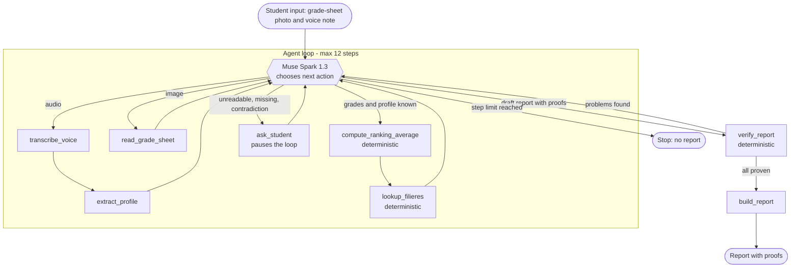

# Architecture

PathProof design document. The expected behaviour is in `docs/prd.md`; here, the technical structure. **The end-to-end CLI loop (E4.4) is wired**; so are the web stream `POST /run` + `POST /answer` (E5.1) and the complete interface (E5.2).

## Agent loop



Tool schemas: declared in a single place, `TOOL_SCHEMAS` in `src/agent/tool_schemas.py` (8 real tools, `zoom_cell` dropped); the loop runs the functions of `src/tools/` by name and contains no business logic. The model's arguments are filtered to the keys declared in `properties` (the schemas remain the single source: an injected `client=...` is ignored, filtering happens in `_execute_tool` only; an empty list `tool_schemas=[]` is the same as the shared schemas) and a malformed or non-object arguments JSON becomes an observation `invalid arguments: ...` without calling the tool (journal: raw payload truncated to 500 characters under `_raw_arguments`). Journal: a JSON list of events `{step, tool, args, result, decision}` (`decision`: `continue`, `suspend`, `stop_unverified`, `stop_step_limit`), one per tool call; the caller passes a `journal` list to `run`, it travels in the suspended and `unverified` states, reusable by the web (E5.1). `unverified` stop: after 3 consecutive refusals from `verify_report` (`MAX_VERIFY_REFUSALS`, non-empty problem list; a proven draft resets the counter, the counter travels in the suspended state), the loop stops without waiting for step 12 and returns `{status: unverified, refused_claims, problems, report, journal, steps_used}`: `refused_claims` (claims of the last draft matched to problems by `claim_id`, `None` ignored, routing and not re-verification) is the input contract of `build_report` (#27), which will list them under "Ce que je n'ai pas pu vérifier", never as facts. A tool exception (including `verify_report`, which then does not touch the refusal counter) or an unknown tool becomes an `{error}` observation, never a crash. An `ask_student` at the 12th step does not suspend: it is journaled `stop_step_limit` and the loop returns `Stopped: step limit reached.`. Pinned draft: when the last `verify_report` returned an empty list, the loop replaces the `report` and `context` arguments of the next `build_report` with the ones that were verified (`_pin_verified_draft`, read from the journal, so also valid after a suspension); the model no longer retypes the JSON, which avoided a drift observed in real runs (an `Mode_entrée` proof copied with the value of `Bac_recommandé`). After a refusal, nothing is replaced, and `build_report` always re-verifies.

System prompt: `SYSTEM_PROMPT` in `src/agent/prompts.py` (E4.3), rewritten for the 8-tool loop and reviewed against PRD §0 and §3.5. It makes the model decide step by step (choose the next tool after each observation; one step = one model turn, independent calls are grouped in the same turn and the `calcul` already returned by `lookup_filieres` is never recomputed, to stay within 12 steps), forbids it to compute or filter itself (averages through `compute_ranking_average`, offers through `lookup_filieres`, only the rows with `Statut_qualité = OK` returned as accessible are recommended), makes it ask through `ask_student` (one question at a time, in French) as soon as a value is unreadable, missing or contradictory (grade outside 0–20, invalid subject, low or absent voice confidence, declared/sheet gap — the sheet prevails), forbids it to invent (no promise or chance of admission, no city, no figure that is unpublished or absent from the `OK` rows, no average for a Concours) and ends it with a JSON draft `{"schema_version": 1, "claims": [...]}` where each claim carries a proof (`grade`, `transcript`, `filiere`, `calc`), then `verify_report` (fix or remove any refused claim, never present it as a fact) and only if the problem list is empty, `build_report`, whose text is rendered unchanged. Coverage locked without network by `tests/test_prompts.py`. Manual replays of 31 October (real API, fictional samples, raw outputs committed): `evals/results/e4.3_blurry_photo.txt` → `ask_student` for a new photo (Mathematics grade unreadable, no grade invented, a merely declared grade is never proven nor computed); `evals/results/e4.3_voice_contradicts_sheet.txt` → independent calls grouped in one step (`transcribe_voice` + `read_grade_sheet`), series confirmation (confidence absent, FR-4) then the gap of 14 declared against 11.2 on the sheet flagged, sheet kept. These manual replays do not replace the E6 evaluations.

The E6.1 cases and their assertions remain in `evals/cases.jsonl`, outside the prompt, the tools and the agent's context: no module of `src/` reads this file. The CLI writes the run journals to `evals/results/`, without loading the assertions. The ten cases point to fictional files listed in `data/samples/README.md`; `tests/test_eval_cases.py` checks the paths, the assertions and the context isolation.

**Evaluation runner (E6.2)**: `python -m evals.run` (`evals/run.py`, assertions in `evals/checks.py`, table in `evals/summary.py`). Without `--live` it lists the cases and sends nothing. `--live [--case <id>]…` runs the real loop (same models as the CLI and the demo, drafting by Wonder) with the scripted student answers of `student_answers` in `cases.jsonl` (chosen from the content of the question, not its position; with no match, an empty answer: the loop stops, as in the CLI), writes one raw output `evals/results/<date>/<id>.json` per case (full journal, verified report, questions, tokens, duration, possible error) then, for a **full** run only, `evals/results/summary.md` (a partial `--case` run leaves the table intact; `--summarize <date>` rebuilds it). `--date` must be a `YYYY-MM-DD` date. A case that crashes is recorded with the tokens, duration and questions already consumed; the deciding models displayed are read from the journals. The assertions are recomputed by code from the raw output (`--summarize <date>` rebuilds the table without the API). `--replay <result.json>` reruns `verify_report` on the last recorded draft and its context and compares with the original problems, with no agent or API. The loop's tokens are counted per model (`TokenUsage.by_model`) and the cost is computed at the official rate of https://dev.meta.ai/docs/pricing-rate-limits (taken on 3 Nov 2026, `PRICE_PER_MILLION_TOKENS` in `evals/summary.py`); the tools' internal calls (vision, profile, transcription) go through their own clients and are not counted, and cached input is billed at full price in the computation: the billing (Billing) is the reference. A result without per-model counts shows an unpriced cost, never an estimate. A tool call in error, or an `ask_student` that did not suspend the loop, does not count as a tool called. `tests/test_eval_run.py` uses no network and guards that neither pytest nor the CI launch `evals.run`.

Step limit: 12 (`MAX_STEPS` in `src/agent/loop.py`, PRD FR-1), counted over the whole run: `steps_used` travels in the suspended state, resumptions included. `ask_student` suspends the loop: `run` returns `{status: needs_input, question, messages, tool_call_id, pending_tool_call_ids, steps_used}` without any additional model or tool call, then `resume(client, model, tool_schemas, suspended, student_answer)` answers **each** pending call of the suspended message — the student's answer for `ask_student`, a `not executed` error for the others, never executed — as `tool` messages, and restarts the loop (the real API refuses a history where a `tool_call_id` remains unanswered); an empty answer returns the same `needs_input` state without calling anything, a malformed state fails outright (missing key). Same mechanism for the CLI (stdin) and the web (`needs_input` event, E5.1).

**CLI (E4.4)**: `python -m src.main [--image <sheet>] [--audio <voice>] [--voice-text <fallback text>] [--journal-out path] [--run-label name] [--answers-file file] [--language fr|en]` (same models as the demo server: `MUSE_CONTRIBUTOR_MODEL`, drafting by `MUSE_WONDER_MODEL`) (`src/main.py`, orchestration in `src/cli_run.py`). The paths passed to the model are **relative to the current directory** when possible (`path_for_agent`); the JSON journal is written in `finally` even if the run crashes. Neighbouring file `{journal.name}.summary.txt` (never the same path as the journal). The report goes to stdout only if the last `verify_report` before `build_report` returned an empty list and its draft and context are identical to those passed to `build_report` (`verified_report_from_journal`). Requires `MUSE_API_KEY`; never run in CI.

## Tools

| Tool | Role | Engine | State |
|---|---|---|---|
| `transcribe_voice` | Transcribe the voice note | Muse Voice Transcribe | implemented (`src/tools/transcribe_voice.py`); output `{text, text_normalized, confidence}` (`text` as heard, quoted by E2.2; `text_normalized` with numbers as digits, `quatorze` → `14`, for extraction; `confidence` `None` as long as the API provides none, so FR-4 applies); any accepted format (`.flac`, `.m4a`, `.mp3`, `.ogg`, `.opus`, `.wav`, `.webm`) converted to 24 kHz mono WAV through ffmpeg (with a maximum delay), result checked (16-bit mono, 10 min and 32 MB at most) before any call; bias `["série C", "série D", "SVT"]`; `TranscriptionError` on failure, never an empty text; raw outputs: `docs/spikes/voice/transcribe_voice/` |
| `extract_profile` | Series, declared average, interests, job, constraints, with exact quote | Muse Spark 1.3 (strict JSON) | implemented (`src/tools/extract_profile.py`); output `{serie_declaree, moyenne_declaree, interets, metier_vise, contraintes, flags}`, each field kept as `{"value", "quote"}` with `quote` copied word for word from the transcript (`text` of `transcribe_voice`); a missing or inexact quote rejects the field by code (scalar → `null`, list element dropped), an unsaid field is `null` (empty list), never a default value; declared values kept as is, a series outside C/D or an average outside 0–20 flagged in `flags` (`serie_non_prise_en_charge`, `moyenne_declaree_hors_plage`), never corrected; no filtering (a city that is mentioned remains a noted constraint, PRD §2.1); `ProfileError` if the JSON is invalid, truncated or off-schema; real call on the coherent note: serie D, 11.2, médecin, Cotonou (issue #16) |
| `read_grade_sheet` | Read the sheet as `[{matiere, note, lisible}]` | Muse Spark 1.3 (vision) | implemented (`src/tools/read_grade_sheet.py`); output `{serie, matieres: [{matiere, note, lisible, flags}], moyenne_affichee, flags}` (average printed on the sheet, copied, never computed), flags `note_hors_plage`, `matiere_inconnue`, `serie_non_prise_en_charge`, `moyenne_hors_plage`; `GradeSheetError` if the JSON is invalid, truncated or of an unsupported image type |
| `zoom_cell` | Isolate a doubtful cell and re-read it | SAM 3.1 + Muse Spark 1.3 | **dropped**: NO GO at spike E0.6 (`docs/decisions.md`); the agent asks for a new photo |
| `compute_ranking_average` | Ranking average of an offer (page 8 formula) | code | implemented (`src/tools/compute_ranking_average.py`) |
| `lookup_filieres` | Filter accessible offers then rank them | code | implemented (`src/tools/lookup_filieres.py`); strict access (`Statut_qualité = OK`, series in `Bac_recommandé`, established page), whole-word ranking on `metier_vise` (all words, plural `s`/`es`: `infirmier` ↔ `infirmiers`, not `pharmacien` ↔ `Pharmacie` nor `médecin` ↔ `Médecine`) and on `interets` (a content word of the phrase, not a preposition like "dans"), then average; ties: `Offre_ID`. If the job is cited on a non-OK row and no OK row matches it, fallback to the average, ties of this fallback only by published `Bourse` quota. `guide_cites_metier` lets `build_report` avoid wrongly writing "aucun débouché" (no career). Output `{accessible[], excluded[]}` |
| `ask_student` | Ask a question, suspend the loop | interface | implemented (`src/tools/ask_student.py` + suspension/resumption in `src/agent/loop.py`); `ask_student(question)` validates by code (non-empty text, a single question — a second "?" is refused, `AskStudentError`) and returns `{status: needs_input, question}`; the question is written in French by the model (system prompt, gap noted in `docs/decisions.md`), an invalid question from the model becomes an error observation and does not suspend; tests without network: tool in `tests/test_ask_student.py`, loop in `tests/test_loop.py` with a scripted, strict fake client (`ScriptedFakeClient` in `tests/fake_client.py`, which refuses an unanswered `tool_call_id` like the real API) |
| `verify_report` | Check every proof of the draft | code | implemented (`src/tools/verify_report.py`); input `(report, context)` with `context = {"serie", "grades", "transcript"}` (grades in the `read_grade_sheet(...)["matieres"]` format), output a list of problems `{claim_id, type, reason}` empty if everything is proven; `grade` compared with the sheet (normalized subject, equal grade, readable row), `transcript` searched word for word, `filiere` checked in `data/offres_publiques_2026_2027.csv` (row `Statut_qualité = OK`, `champ`/`valeur` equal to the row) and `data/pages_offres.csv` (equal page), `calc` recomputed by `compute_ranking_average` from the series, the context's grades and the coefficients (formula, inputs and `moyenne_arrondie` compared); form problems taken from `validate_report`; fails closed (malformed report, missing context or exception in a check = problem, never an empty list) and refuses without an expected value (the recomputed result never appears in a reason); no SDK import, no network |
| `build_report` | Format the validated report | code | implemented (`src/tools/build_report.py`); input `(report, context, refused_claims=None)`, output text in 6 sections (French by default, English via `language="en"`, templates in `src/domain/report_text.py`) (Accessibilité, Correspondance, Quotas du guide, Moyenne de classement with page 8 formula and provenance, 3 choices for apresmonbac.bj with at least one Classical Faculty read from `data/faculte_classique.csv` via `load_faculte_classique_by_id`, Ce que je n'ai pas pu vérifier); refuses (`ValueError`) if `verify_report` refuses, beyond 5 offers, without `Offre_ID`/page, without a `Bac_recommandé`/`Mode_entrée` proof (series re-checked, unpublished mode stated instead of proven), ambiguous calculation (one `calc` for two offers), or an admission promise in the agent's sentences (quotes "..." and cited guide fields as published excluded); `unverified` path: only the verified ones are presented, the refused ones listed by `claim_id` without value; choices in draft order (Faculties first), message if fewer than 3 or without a Faculty; with no verified offer, says so instead of recommending (FR-9) and, if there is a student quote, Correspondance says no career in the guide cites this job (PRD §5 `false_friend`, FR and EN); at most 5 offers |

Domain building blocks (pure code, no network): `src/domain/guide.py` (`load_offer_rows`, `load_pages_by_id`, `load_faculte_classique_by_id`, `OK_STATUS`: reading of the guide's CSVs, shared by `verify_report` and the vertical slice, also read by `lookup_filieres` in E3.5 and by `build_report` in E4.2), `src/domain/coefficients.py` (`load_coefficients(serie)`: series C and D, group 1, without PE), `src/domain/grade_scale.py` (`MIN_GRADE`, `MAX_GRADE`, `is_on_grade_scale`: 0–20 scale shared by `compute_ranking_average`, `read_grade_sheet` and `extract_profile`), `src/domain/subjects.py` (`normalize_subject(raw)`: `UnknownSubjectError` if the subject is unknown), `src/domain/offer_subjects.py` (`parse_subjects_by_series(matieres)`: splitting of the `Matières` column on the series headings, glued headings included, normalized subjects or raw label kept, cell "—" → `{}`; `subjects_for_serie(row, serie)`: `{status, subjects, epreuves, reason}` with statuses `calculable`, `non calculable`, `matières non publiées` and `concours` — exams listed as published, no BAC subject assumed), `src/domain/proofs.py` (`SCHEMA_VERSION = 1`, `validate_proof`, `validate_report`: proof format frozen on D2), and `src/domain/faculte_classique.py` (`FACULTE_PREFIX`, `is_faculte_label`, `REVIEWED_EXCEPTIONS`, `build_faculte_column`: rule "starts with the word Faculté" with case/accents/spaces ignored, 3 INSTI exceptions keyed on the quarantined label, failing when stale).

E2.5 vertical slice (not a tool: neither the model nor the loop calls it): `src/vertical_slice.py` chains JSON fixture → `compute_ranking_average` → provisional search (`Statut_qualité = OK` + `Bac_recommandé`, simple `Matières` segment, additional filters noted in `docs/decisions.md`) → draft with proofs → `verify_report`; command `scripts/run_vertical_slice.py`.

## Proofs and verifier

The report is first a JSON where each claim (`claim`) carries at least one proof. The format is **frozen** (E1.4, `SCHEMA_VERSION = 1` in `src/domain/proofs.py`): after D2, it no longer changes without an entry in `docs/decisions.md`.

| Type | Mandatory fields | Reference checked by `verify_report` |
|---|---|---|
| `grade` | `matiere` (text), `note` (number) | the grade read on the photo |
| `transcript` | `quote` (text) | the quote exists word for word in the transcript |
| `filiere` | `offre_id` (text), `page_pdf` (integer ≥ 1), `champ` (text: CSV column), `valeur` (text or number) | the `Offre_ID` of a row with `Statut_qualité = OK`, its PDF page (`data/pages_offres.csv`) and the value announced in the column |
| `calc` | `formula` (text), `inputs` (non-empty list), `result` (number) | the result of `compute_ranking_average` (`moyenne_arrondie`), recomputed |

Each claim carries a `claim_id` (non-empty text, unique in the report), a `text` and at least one proof. `validate_report` checks the form (schema version, `claim_id`, text, proofs, fields and types, entries of `calc.inputs`, no unknown key (report, claim or proof) nor non-finite number) and returns the list of problems `{claim_id, type, reason}`, empty if everything is in order (`type = structure` for these form problems, null `claim_id` for those of the whole report). `verify_report` (E2.4) reuses these problems as they are, then checks that each reference exists and matches: it is **code**, not a second call to the model. As long as it returns a problem, no report is displayed (FR-8).

Example of a complete report (the claim texts are in French, as the agent writes them):

```json
{
  "schema_version": 1,
  "claims": [
    {
      "claim_id": "svt-grade",
      "text": "SVT : 15/20 au relevé.",
      "proofs": [{"type": "grade", "matiere": "SVT", "note": 15}]
    },
    {
      "claim_id": "doctor-goal",
      "text": "Tu as dit vouloir être médecin (« peut-être médecin »).",
      "proofs": [{"type": "transcript", "quote": "peut-être médecin"}]
    },
    {
      "claim_id": "medecine-access",
      "text": "Médecine Générale (FSS) : 95 bourses prévues, moyenne de classement 13,15.",
      "proofs": [
        {"type": "filiere", "offre_id": "PUB-062", "page_pdf": 36, "champ": "Bourse", "valeur": 95},
        {"type": "calc", "formula": "M = Σ(mi·ci) / Σci",
         "inputs": [{"matiere": "SVT", "note": 15, "coefficient": 5},
                    {"matiere": "Mathématiques", "note": 12, "coefficient": 4},
                    {"matiere": "Sciences Physiques (PCT/SPCT)", "note": 12, "coefficient": 4}],
         "result": 13.15}
      ]
    }
  ]
}
```

## Data

| File | Role |
|---|---|
| `data/offres_publiques_2026_2027.csv` | 224 offers; main source of `lookup_filieres` |
| `data/series_et_offres_2026_2027.csv` | 897 series–offer pairs; index by series |
| `data/controle_qualite_2026_2027.csv` | 39 anomalies; "Ce que je n'ai pas pu vérifier" section |
| `data/pages_offres.csv` | offer → page of the official PDF (E3.5: 224 offers with an established page, the 7 E3.2 quarantines restored as `verifie_main` after fixing the labels) |
| `data/faculte_classique.csv` | recommendable offer (`OK` with an established page) → `oui`/`non` (page 9 instruction, E3.4): 57 `oui`, 149 `non`, produced by `scripts/make_faculte_classique.py` (rule "starts with Faculté"; INSTI exceptions removed in E3.5, labels repaired) |
| `data/coefficients_bac_benin.json` | BAC coefficients per series (group 1); input of `compute_ranking_average` |
| `data/filieres.csv` | old empty template, deleted in E3.5 with the rewrite of `lookup_filieres` |

The guide PDF is not versioned (`data/source/`, ignored by git). Quality control: `docs/data-audit.md` (E3.3) compares 20 randomly drawn `OK` rows (seed 2026, `scripts/sample_audit.py`) with the PDF: 5 gaps out of 20, threshold crossed → decision in `docs/decisions.md` (fix + restrict, in E3.5).

## Decisions

- Python, OpenAI SDK pointed at `https://api.meta.ai/v1`.
- No speech synthesis (the Meta API offers none).
- Strict access (`OK` rows, series in `Bac_recommandé`, entry mode displayed), explained ranking. Detail: `docs/prd.md` section 3.
- The model never computes an average or a filter: these are deterministic tools.
- No real student data; fictional sheets and voice notes only.
- `MUSE_API_KEY` server side only, in `.env`.

## Web server (E5.1)

`src/api/server.py` contains no business logic: it validates the uploads (image `.jpg`/`.jpeg`/`.png` 10 MB at most, audio in the `transcribe_voice` formats 32 MB at most, read in 1 MB blocks with 413/415, `image` or `text` required, 429 beyond 100 suspended runs or 5 runs in progress), stores them under `tmp/pathproof-<run_id>/` (relative paths via `path_for_agent`, never a personal path in the journal, tmpdir deleted if writing or starting fails), then calls `loop.run` / `loop.resume` with `TOOL_SCHEMAS`, `MUSE_CONTRIBUTOR_MODEL` and `drafting_model=MUSE_WONDER_MODEL` (E5.7) in a thread while the response follows the journal and streams each step as SSE `text/event-stream` (`{step, tool, args, result, decision}` in order, including before a late error; the steps of a failed attempt are announced by a `rollback` frame that the front end removes before the retry). Suspended sessions live in `PendingRunStore` (`src/api/run_store.py`, single lock — no mutable global — 30 min TTL with purge on each request, cap checked under the same lock, atomic claim of the `run_id` on `/answer` against double resumptions, restoration of the pre-answer state at settle time on error to replay without duplicating the `tool` answers, `tmp/` ignored by git). Settlement goes through `AgentRunHandle.settle_once` (unique and idempotent): the worker starts when the handle is created, so even a client that left before the first frame is settled by the background finisher once the loop is over, and the slot is only released after the worker ends (never on mere disconnection). The `rollback` frame is only emitted on `/answer` (`rollback_state`), never on `/run`, whose trace stays displayed on error. `POST /answer` (`run_id`, `answer`) resumes the suspension and streams the new steps. Errors become an `error` event (never a raw 500, key redacted from the values before `json.dumps`, the name `MUSE_API_KEY` never returned). Accepted limit: single process, a restart or a second worker loses the sessions (no shared storage on Vercel, limit accepted in E5.4: see `docs/deploy.md` and `docs/decisions.md`). Coverage without network: `tests/test_api_run.py` (`TestClient`, order, `needs_input`/`/answer`, resumption after error with `rollback`, disconnection and unreadable frame cleaned up, 404/413/415/429, `error`, absence of key and of 501) and `tests/test_run_store.py` (lock, unique claim under threads, idempotent slots).

## Web interface (E5.2)

`web/` (static, served by the same server): `index.html` (presentation) and `demo.html` (the demo, E5.6), modules `models.js` (Meta model per tool), `agent-map.js`, `motion.js`, `landing.js`, `styles.css`, and `js/` as single-responsibility ES modules — `i18n.js` (texts, English by default for the English-speaking jury, French as an `EN`/`FR` toggle saved if local storage is allowed, the verified report following the language sent to `POST /run`, E5.6), `format.js`, `api.js` (base, SSE stream, errors, retry of the `health` probe after failure), `steps.js` (trace), `proofs.js` (sources), `report.js` (report and claims), `app.js` (orchestration only); sending photo + voice note with a fallback text field, SSE trace displayed as it happens (tool, input, output, decision), `ask_student` questions with an answer field, then the verified report followed by its claims. Each proof of a claim is a button that opens its source in a dialog: grades and transcript come from the `context` of the accepted `verify_report` step; the guide row (`Offre_ID`, PDF page, proven field and `lookup_filieres` row) is searched in all the displayed search results, with a notice if it is missing; the calculation (page 8 formula, grades × coefficients) adds the decimals exactly then rounds at display time. The displayed claims are those of the draft that the streamed `verify_report` step accepted (empty problem list); no new payload on the server side, the front end rereads the steps already received. One-click fictional examples: `GET /samples/{name}` serves read-only the 5 files of `data/samples/` (allow-list `SAMPLE_MEDIA_TYPES`, any other name gets a 404), the front end fetches them and sends them through the same `POST /run`. All displayed content is escaped (`escapeHtml`) or written as `textContent`; the verification banner stays hidden as long as there is no verified report. The trace cards are added as the steps come in, which keeps the open details; the full update for a language change is forced separately. Tests without network: `tests/test_web_ui.py`; real full run in a browser: captures `docs/e5.2-demo-report-375px.png` and `docs/e5.2-demo-375px.png`.

## Degraded mode (E5.3)

`web/recorded-run.json` is a static resource, deployed with the web files (never written to the ephemeral file system of a Vercel function). It contains the trace and the report of a successful run on the fixed fictional samples `releve_serie_d.jpg` and `note_vocale_coherente.mp3` only. `scripts/record_demo.py` runs these samples through the real client and writes the file after confirming a normal end, an empty `verify_report` and a `build_report` identical on the accepted draft and context. The generator checks the single exact expected question before the report verification, rejects other paths and any non-compliant report; no external journal is accepted as input. The report text displayed as a recording is neutralized so as not to claim to have been verified in the current session. Live generation requires `MUSE_API_KEY` and consumes credits; it is not launched by the tests.

On load, `api.js` preloads the 127 KB of the recording in memory: this per-page cost is intentional to keep the fallback if connectivity drops after loading. A network failure, an interrupted stream, an SSE error categorized `infrastructure` or an HTTP 5xx response from `POST /run` or `POST /answer` trigger the fallback; HTTP 4xx/429 responses and application/capacity SSE errors remain visible without replacing the live trace. The static file's report is rendered without a verification badge or proof controls, because it does not concern the inputs of the attempt. On a retryable `/answer` error, the browser keeps the session identifier, the question, the typed answer and the live trace; a new attempt restores this state before resending the answer. A 404 restores the pre-answer trace then closes the expired session. Without a readable static resource, the interface shows the error and restores the live state of a resumption; for a new submission, it clears the partial steps. Coverage: `tests/test_recorded_run.py` and `tests/test_cli_run.py` (origin and integrity of the journal), `tests/test_web_fallback.py` (error classification and fixture integrity), `tests/test_web_ui.py` (static asset and notice); the server and browser scenarios are detailed in these tests and in the PR history.

## Points to confirm

- **Muse Spark 1.3 tool calling (function calling): observed, not documented.** `scripts/test_muse_tool_call.py` (report: `docs/muse-spark-tool-call-results.md`) shows 5 passes out of 5 with a single tool `lookup_filieres` and a single question. The choice between two tools and the return of the result are tested in `docs/muse-spark-roundtrip-results.md` (5 out of 5); chained calls are not observed: the model requests both tools in parallel in the same turn, so the loop (E4.1) must return one `tool` message per call. Vision is tested in spike E0.4 (`docs/decisions.md`). Reported results, not replayed by us.
- **Muse Voice Transcribe**: taken from the official docs and tested in French (spike E0.5, see `docs/decisions.md`). `muse-voice-transcribe-1.0`, `POST https://api.meta.ai/v1/asr/transcribe` as `multipart/form-data` (JSON `request` and `audio` parts), mono 16-bit PCM WAV at 16 or 24 kHz only, 10 min and 32 MB at most, no confidence score.
- **Image upload format**: base64 data URL `image/jpeg` in an `image_url` message, observed with `muse-spark-1.3` (spike E0.4, `docs/spikes/vision/`). Maximum accepted size not found in the docs and not tested.
- **SAM 3.1**: tested (spike E0.6, `docs/spikes/sam/`). `sam-3.1` through `POST https://api.meta.ai/v1/responses` finds the table (prompt "table"), never the targeted cell (0 out of 3, sharp and blurry). NO GO: no `zoom_cell`.
