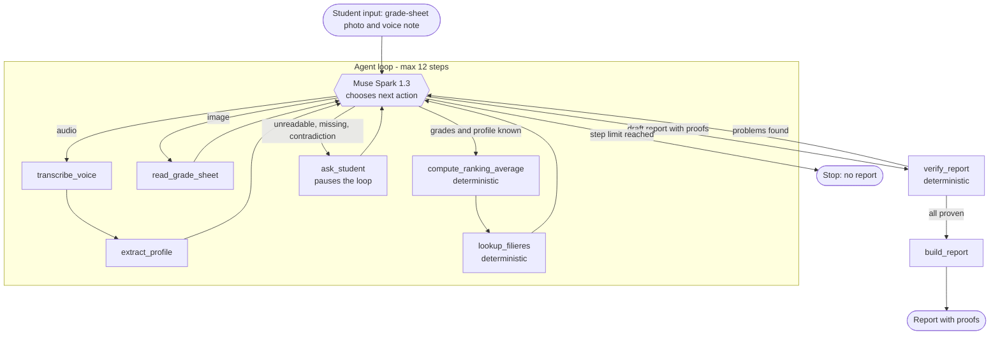

# Architecture

Document de conception de PathProof. Le comportement attendu est dans `docs/prd.md` ; ici, la structure technique. **Rien de ceci n'est encore implémenté de bout en bout** (voir la colonne « État »).

## Boucle de l'agent



Schémas des outils : déclarés à un seul endroit, `TOOL_SCHEMAS` dans `src/agent/tool_schemas.py` (8 outils réels, `zoom_cell` abandonné) ; la boucle exécute par nom les fonctions de `src/tools/` et ne contient aucune logique métier. Les arguments du modèle sont filtrés aux clés déclarées dans `properties` (les schémas restent la source unique : un `client=...` injecté est ignoré, filtrage dans `_execute_tool` uniquement ; une liste vide `tool_schemas=[]` vaut les schémas partagés) et un JSON d'arguments malformé ou non-objet devient une observation `invalid arguments: ...` sans appeler l'outil (journal : charge brute tronquée à 500 caractères sous `_raw_arguments`). Journal : liste JSON d'événements `{step, tool, args, result, decision}` (`decision` : `continue`, `suspend`, `stop_unverified`, `stop_step_limit`), un par appel d'outil ; l'appelant passe une liste `journal` à `run`, elle voyage dans les états suspendu et `unverified`, réutilisable par le web (E5.1). Arrêt `unverified` : après 3 refus consécutifs de `verify_report` (`MAX_VERIFY_REFUSALS`, liste de problèmes non vide ; un brouillon prouvé remet le compteur à zéro, le compteur voyage dans l'état suspendu), la boucle s'arrête sans attendre le pas 12 et renvoie `{status: unverified, refused_claims, problems, report, journal, steps_used}` : `refused_claims` (affirmations du dernier brouillon appariées aux problèmes par `claim_id`, `None` ignorés, routage et non revérification) est le contrat d'entrée de `build_report` (#27), qui les listera sous « Ce que je n'ai pas pu vérifier », jamais comme des faits. Une exception d'outil (y compris `verify_report`, qui ne touche alors pas le compteur de refus) ou un outil inconnu devient une observation `{error}`, jamais un plantage. Un `ask_student` au 12e pas ne suspend pas : il est journalisé `stop_step_limit` et la boucle renvoie `Stopped: step limit reached.`. Brouillon épinglé : quand le dernier `verify_report` a renvoyé une liste vide, la boucle remplace les arguments `report` et `context` du `build_report` suivant par ceux qui ont été vérifiés (`_pin_verified_draft`, lu dans le journal, donc valable aussi après une suspension) ; le modèle ne retape plus le JSON, ce qui évitait une dérive observée en réel (une preuve `Mode_entrée` recopiée avec la valeur de `Bac_recommandé`). Après un refus, rien n'est remplacé, et `build_report` re-vérifie toujours.

Prompt système : `SYSTEM_PROMPT` dans `src/agent/prompts.py` (E4.3), réécrit pour la boucle à 8 outils et relu face au PRD §0 et §3.5. Il fait décider le modèle pas à pas (choisir l'outil suivant après chaque observation ; un pas = un tour du modèle, les appels indépendants sont groupés dans le même tour et le `calcul` déjà renvoyé par `lookup_filieres` n'est jamais recalculé, pour tenir les 12 pas), lui interdit de calculer ou de filtrer lui-même (moyennes par `compute_ranking_average`, offres par `lookup_filieres`, seules les lignes `Statut_qualité = OK` retournées comme accessibles sont recommandées), lui fait demander via `ask_student` (une question à la fois, en français) dès qu'une valeur est illisible, manquante ou contradictoire (note hors 0–20, matière invalide, confiance vocale faible ou absente, écart déclaré/relevé — le relevé prévaut), lui interdit d'inventer (aucune promesse ni chance d'admission, aucune ville, aucun chiffre non publié ou absent des lignes `OK`, aucune moyenne pour un Concours) et le termine par un brouillon JSON `{"schema_version": 1, "claims": [...]}` où chaque affirmation porte une preuve (`grade`, `transcript`, `filiere`, `calc`), puis `verify_report` (corriger ou retirer toute affirmation refusée, jamais la présenter comme un fait) et seulement si la liste de problèmes est vide, `build_report`, dont le texte est rendu inchangé. Couverture verrouillée sans réseau par `tests/test_prompts.py`. Rejeux manuels du 31 octobre (API réelle, échantillons fictifs, sorties brutes commitées) : `evals/results/e4.3_blurry_photo.txt` → `ask_student` pour une nouvelle photo (note de Mathématiques illisible, aucune note inventée, une note seulement déclarée n'est jamais prouvée ni calculée) ; `evals/results/e4.3_voice_contradicts_sheet.txt` → appels indépendants groupés en un pas (`transcribe_voice` + `read_grade_sheet`), confirmation de série (confiance absente, FR-4) puis écart 14 déclaré contre 11,2 au relevé signalé, relevé conservé. Ces rejeux manuels ne remplacent pas les évaluations E6.

Limite de pas : 12 (`MAX_STEPS` dans `src/agent/loop.py`, PRD FR-1), comptés sur toute l'exécution : `steps_used` voyage dans l'état suspendu, reprises comprises. `ask_student` suspend la boucle : `run` renvoie `{status: needs_input, question, messages, tool_call_id, pending_tool_call_ids, steps_used}` sans aucun appel de modèle ni d'outil supplémentaire, puis `resume(client, model, tool_schemas, suspended, student_answer)` répond à **chaque** appel en attente du message suspendu — la réponse de l'élève pour `ask_student`, une erreur `not executed` pour les autres, jamais exécutés — comme messages `tool`, et relance la boucle (la vraie API refuse un historique où un `tool_call_id` reste sans réponse) ; une réponse vide renvoie le même état `needs_input` sans rien appeler, un état mal formé échoue franchement (clé manquante). Même mécanisme pour la CLI (stdin) et le web (événement `needs_input`, E5.1).

## Outils

| Outil | Rôle | Moteur | État |
|---|---|---|---|
| `transcribe_voice` | Transcrire la note vocale | Muse Voice Transcribe | implémenté (`src/tools/transcribe_voice.py`) ; sortie `{text, text_normalized, confidence}` (`text` tel qu'entendu, cité par E2.2 ; `text_normalized` avec les nombres en chiffres, `quatorze` → `14`, pour l'extraction ; `confidence` `None` tant que l'API n'en fournit pas, donc FR-4 s'applique) ; tout format accepté (`.flac`, `.m4a`, `.mp3`, `.ogg`, `.opus`, `.wav`, `.webm`) converti en WAV 24 kHz mono via ffmpeg (avec délai maximal), résultat vérifié (mono 16 bits, 10 min et 32 Mo au plus) avant tout appel ; biais `["série C", "série D", "SVT"]` ; `TranscriptionError` en cas d'échec, jamais un texte vide ; sorties brutes : `docs/spikes/voice/transcribe_voice/` |
| `extract_profile` | Série, moyenne déclarée, intérêts, métier, contraintes, avec citation exacte | Muse Spark 1.3 (JSON strict) | implémenté (`src/tools/extract_profile.py`) ; sortie `{serie_declaree, moyenne_declaree, interets, metier_vise, contraintes, flags}`, chaque champ gardé `{"value", "quote"}` avec `quote` copiée mot pour mot de la transcription (`text` de `transcribe_voice`) ; une citation absente ou inexacte rejette le champ par code (scalaire → `null`, élément de liste écarté), un champ non dit est `null` (liste vide), jamais une valeur par défaut ; valeurs déclarées gardées telles quelles, série hors C/D ou moyenne hors 0–20 signalée dans `flags` (`serie_non_prise_en_charge`, `moyenne_declaree_hors_plage`), jamais corrigée ; aucun filtrage (une ville dite reste une contrainte notée, PRD §2.1) ; `ProfileError` si le JSON est invalide, tronqué ou hors schéma ; appel réel sur la note cohérente : série D, 11,2, médecin, Cotonou (issue #16) |
| `read_grade_sheet` | Lire le relevé en `[{matiere, note, lisible}]` | Muse Spark 1.3 (vision) | implémenté (`src/tools/read_grade_sheet.py`) ; sortie `{serie, matieres: [{matiere, note, lisible, flags}], moyenne_affichee, flags}` (moyenne imprimée sur le relevé, copiée, jamais calculée), drapeaux `note_hors_plage`, `matiere_inconnue`, `serie_non_prise_en_charge`, `moyenne_hors_plage` ; `GradeSheetError` si le JSON est invalide, tronqué ou d'un type d'image non géré |
| `zoom_cell` | Isoler une cellule douteuse et la relire | SAM 3.1 + Muse Spark 1.3 | **abandonné** : NO GO au spike E0.6 (`docs/decisions.md`) ; l'agent demande une nouvelle photo |
| `compute_ranking_average` | Moyenne de classement d'une offre (formule page 8) | code | implémenté (`src/tools/compute_ranking_average.py`) |
| `lookup_filieres` | Filtrer les offres accessibles puis les classer | code | implémenté (`src/tools/lookup_filieres.py`) ; accès strict (`Statut_qualité = OK`, série dans `Bac_recommandé`, page établie), classement par mots entiers sur `metier_vise`/`interets`, moyenne via `compute_ranking_average` hors Concours ; sortie `{accessible[], excluded[]}` avec raisons, `Offre_ID`, `page_pdf` et mode d'entrée, 5 accessibles au plus |
| `ask_student` | Poser une question, suspendre la boucle | interface | implémenté (`src/tools/ask_student.py` + suspension/reprise dans `src/agent/loop.py`) ; `ask_student(question)` valide par code (texte non vide, une seule question — un second « ? » est refusé, `AskStudentError`) et renvoie `{status: needs_input, question}` ; la question est rédigée en français par le modèle (prompt système, écart noté dans `docs/decisions.md`), une question invalide du modèle devient une observation d'erreur et ne suspend pas ; tests sans réseau : outil dans `tests/test_ask_student.py`, boucle dans `tests/test_loop.py` avec un faux client scripté et strict (`ScriptedFakeClient` dans `tests/fake_client.py`, qui refuse un `tool_call_id` sans réponse comme la vraie API) |
| `verify_report` | Contrôler chaque preuve du brouillon | code | implémenté (`src/tools/verify_report.py`) ; entrée `(report, context)` avec `context = {"serie", "grades", "transcript"}` (grades au format `read_grade_sheet(...)["matieres"]`), sortie liste de problèmes `{claim_id, type, reason}` vide si tout est prouvé ; `grade` comparée au relevé (matière normalisée, note égale, ligne lisible), `transcript` cherchée mot pour mot, `filiere` contrôlée dans `data/offres_publiques_2026_2027.csv` (ligne `Statut_qualité = OK`, `champ`/`valeur` égaux à la ligne) et `data/pages_offres.csv` (page égale), `calc` recalculée par `compute_ranking_average` depuis la série, les notes du contexte et les coefficients (formule, entrées et `moyenne_arrondie` comparés) ; problèmes de forme repris de `validate_report` ; échec fermé (rapport mal formé, contexte absent ou exception d'un contrôle = problème, jamais une liste vide) et refus sans valeur attendue (le résultat recalculé n'apparaît jamais dans une raison) ; aucun import SDK, aucun réseau |
| `build_report` | Mettre en forme le rapport validé | code | implémenté (`src/tools/build_report.py`) ; entrée `(report, context, refused_claims=None)`, sortie texte français en 6 sections (Accessibilité, Correspondance, Quotas du guide, Moyenne de classement avec formule page 8 et provenance, 3 choix pour apresmonbac.bj avec au moins une Faculté classique lue dans `data/faculte_classique.csv` via `load_faculte_classique_by_id`, Ce que je n'ai pas pu vérifier) ; refuse (`ValueError`) si `verify_report` refuse, au-delà de 5 offres, sans `Offre_ID`/page, sans preuve `Bac_recommandé`/`Mode_entrée` (série revérifiée, mode non publié dit au lieu d'être prouvé), calcul ambigu (un `calc` pour deux offres), ou promesse d'admission dans les phrases de l'agent (citations « ... » et champs du guide cités tels que publiés exclus) ; chemin `unverified` : seules les vérifiées sont présentées, les refusées listées par `claim_id` sans valeur ; choix dans l'ordre du brouillon (Facultés d'abord), message si moins de 3 ou sans Faculté ; sans offre vérifiée, le dit au lieu de recommander (FR-9) ; au plus 5 offres |

Briques du domaine (code pur, sans réseau) : `src/domain/guide.py` (`load_offer_rows`, `load_pages_by_id`, `load_faculte_classique_by_id`, `OK_STATUS` : lecture des CSV du guide, partagée par `verify_report` et la tranche verticale, lue aussi par `lookup_filieres` en E3.5 et par `build_report` en E4.2), `src/domain/coefficients.py` (`load_coefficients(serie)` : séries C et D, groupe 1, sans EPS), `src/domain/grade_scale.py` (`MIN_GRADE`, `MAX_GRADE`, `is_on_grade_scale` : échelle 0–20 partagée par `compute_ranking_average`, `read_grade_sheet` et `extract_profile`), `src/domain/subjects.py` (`normalize_subject(raw)` : `UnknownSubjectError` si la matière est inconnue), `src/domain/offer_subjects.py` (`parse_subjects_by_series(matieres)` : découpage de la colonne `Matières` sur les en-têtes de série, en-têtes collés compris, matières normalisées ou libellé brut conservé, cellule « — » → `{}` ; `subjects_for_serie(row, serie)` : `{status, subjects, epreuves, reason}` avec statuts `calculable`, `non calculable`, `matières non publiées` et `concours` — épreuves listées telles que publiées, aucune matière du Bac supposée), `src/domain/proofs.py` (`SCHEMA_VERSION = 1`, `validate_proof`, `validate_report` : format des preuves figé au J2), et `src/domain/faculte_classique.py` (`FACULTE_PREFIX`, `is_faculte_label`, `REVIEWED_EXCEPTIONS`, `build_faculte_column` : règle « commence par le mot Faculté » avec casse/accents/espaces ignorés, 3 exceptions INSTI clées sur le libellé mis en quarantaine, périmées en échec).

Tranche verticale E2.5 (pas un outil : ni le modèle ni la boucle ne l'appellent) : `src/vertical_slice.py` enchaîne fixture JSON → `compute_ranking_average` → recherche provisoire (`Statut_qualité = OK` + `Bac_recommandé`, segment `Matières` simple, filtres supplémentaires notés dans `docs/decisions.md`) → brouillon avec preuves → `verify_report` ; commande `scripts/run_vertical_slice.py`.

## Preuves et vérificateur

Le rapport est d'abord un JSON où chaque affirmation (`claim`) porte au moins une preuve. Le format est **figé** (E1.4, `SCHEMA_VERSION = 1` dans `src/domain/proofs.py`) : après le J2, il ne change plus sans une entrée dans `docs/decisions.md`.

| Type | Champs obligatoires | Référence contrôlée par `verify_report` |
|---|---|---|
| `grade` | `matiere` (texte), `note` (nombre) | la note lue sur la photo |
| `transcript` | `quote` (texte) | la citation existe mot pour mot dans la transcription |
| `filiere` | `offre_id` (texte), `page_pdf` (entier ≥ 1), `champ` (texte : colonne du CSV), `valeur` (texte ou nombre) | l'`Offre_ID` d'une ligne `Statut_qualité = OK`, sa page du PDF (`data/pages_offres.csv`) et la valeur annoncée dans la colonne |
| `calc` | `formula` (texte), `inputs` (liste non vide), `result` (nombre) | le résultat de `compute_ranking_average` (`moyenne_arrondie`), recalculé |

Chaque affirmation porte un `claim_id` (texte non vide, unique dans le rapport), un `text` et au moins une preuve. `validate_report` contrôle la forme (version du schéma, `claim_id`, texte, preuves, champs et types, entrées de `calc.inputs`, aucune clé inconnue (rapport, affirmation ou preuve) ni nombre non fini) et renvoie la liste des problèmes `{claim_id, type, reason}`, vide si tout est en règle (`type = structure` pour ces problèmes de forme, `claim_id` nul pour ceux du rapport entier). `verify_report` (E2.4) réutilise ces problèmes tels quels, puis vérifie que chaque référence existe et correspond : c'est du **code**, pas un second appel au modèle. Tant qu'il renvoie un problème, aucun rapport n'est affiché (FR-8).

Exemple de rapport complet :

```json
{
  "schema_version": 1,
  "claims": [
    {
      "claim_id": "svt-grade",
      "text": "SVT : 15/20 au relevé.",
      "proofs": [{"type": "grade", "matiere": "SVT", "note": 15}]
    },
    {
      "claim_id": "doctor-goal",
      "text": "Tu as dit vouloir être médecin (« peut-être médecin »).",
      "proofs": [{"type": "transcript", "quote": "peut-être médecin"}]
    },
    {
      "claim_id": "medecine-access",
      "text": "Médecine Générale (FSS) : 95 bourses prévues, moyenne de classement 13,15.",
      "proofs": [
        {"type": "filiere", "offre_id": "PUB-062", "page_pdf": 36, "champ": "Bourse", "valeur": 95},
        {"type": "calc", "formula": "M = Σ(mi·ci) / Σci",
         "inputs": [{"matiere": "SVT", "note": 15, "coefficient": 5},
                    {"matiere": "Mathématiques", "note": 12, "coefficient": 4},
                    {"matiere": "Sciences Physiques (PCT/SPCT)", "note": 12, "coefficient": 4}],
         "result": 13.15}
      ]
    }
  ]
}
```

## Données

| Fichier | Rôle |
|---|---|
| `data/offres_publiques_2026_2027.csv` | 224 offres ; source principale de `lookup_filieres` |
| `data/series_et_offres_2026_2027.csv` | 897 couples série–offre ; index par série |
| `data/controle_qualite_2026_2027.csv` | 39 anomalies ; section « Ce que je n'ai pas pu vérifier » |
| `data/pages_offres.csv` | offre → page du PDF officiel (E3.5 : 224 offres à page établie, les 7 quarantaines E3.2 rétablies en `verifie_main` après correction des libellés) |
| `data/faculte_classique.csv` | offre recommandable (`OK` à page établie) → `oui`/`non` (consigne page 9, E3.4) : 57 `oui`, 149 `non`, produit par `scripts/make_faculte_classique.py` (règle « commence par Faculté » ; exceptions INSTI retirées en E3.5, libellés réparés) |
| `data/coefficients_bac_benin.json` | coefficients du Bac par série (groupe 1) ; entrée de `compute_ranking_average` |
| `data/filieres.csv` | ancien gabarit vide, supprimé en E3.5 avec la réécriture de `lookup_filieres` |

Le PDF du guide n'est pas versionné (`data/source/`, ignoré par git). Contrôle qualité : `docs/data-audit.md` (E3.3) compare 20 lignes `OK` tirées au hasard (graine 2026, `scripts/sample_audit.py`) au PDF : 5 écarts sur 20, seuil franchi → décision dans `docs/decisions.md` (corriger + restreindre, en E3.5).

## Décisions

- Python, SDK OpenAI pointé sur `https://api.meta.ai/v1`.
- Pas de synthèse vocale (l'API Meta n'en propose pas).
- Accès strict (lignes `OK`, série dans `Bac_recommandé`, mode d'entrée affiché), classement expliqué. Détail : `docs/prd.md` section 3.
- Le modèle ne calcule jamais une moyenne ni un filtre : ce sont des outils déterministes.
- Aucune donnée réelle d'élève ; relevés et notes vocales fictifs uniquement.
- `MUSE_API_KEY` côté serveur uniquement, dans `.env`.

## Points à confirmer

- **Appel d'outils (function calling) de Muse Spark 1.3 : observé, non documenté.** `scripts/test_muse_tool_call.py` (rapport : `docs/muse-spark-tool-call-results.md`) montre 5 réussites sur 5 avec un seul outil `lookup_filieres` et une seule question. Le choix entre deux outils et le renvoi du résultat sont testés dans `docs/muse-spark-roundtrip-results.md` (5 sur 5) ; les appels enchaînés ne sont pas observés : le modèle demande les deux outils en parallèle dans un même tour, donc la boucle (E4.1) doit renvoyer un message `tool` par appel. La vision est testée dans le spike E0.4 (`docs/decisions.md`). Résultats rapportés, non rejoués par nous.
- **Muse Voice Transcribe** : relevé dans la doc officielle et testé en français (spike E0.5, voir `docs/decisions.md`). `muse-voice-transcribe-1.0`, `POST https://api.meta.ai/v1/asr/transcribe` en `multipart/form-data` (parties `request` JSON et `audio`), WAV mono PCM 16 bits à 16 ou 24 kHz uniquement, 10 min et 32 Mo au plus, aucun score de confiance.
- **Format d'envoi des images** : data URL base64 `image/jpeg` dans un message `image_url`, observé avec `muse-spark-1.3` (spike E0.4, `docs/spikes/vision/`). Taille maximale acceptée non trouvée dans la doc et non testée.
- **SAM 3.1** : testé (spike E0.6, `docs/spikes/sam/`). `sam-3.1` via `POST https://api.meta.ai/v1/responses` trouve le tableau (prompt « table »), jamais la cellule visée (0 sur 3, net et flou). NO GO : pas de `zoom_cell`.
